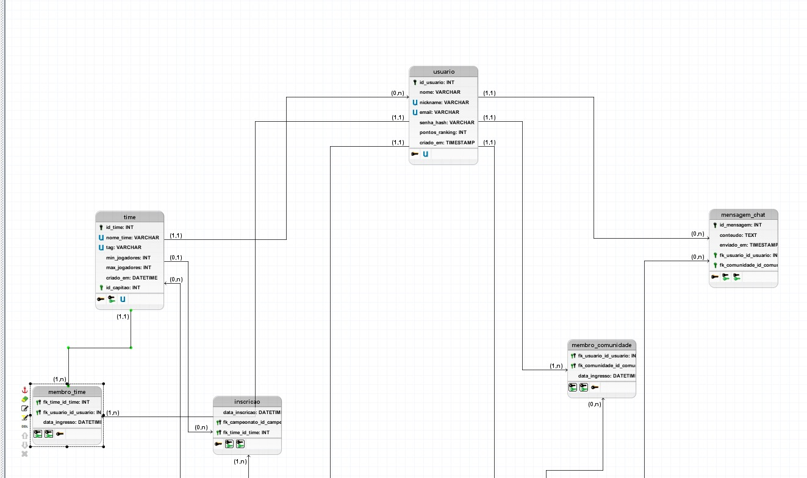
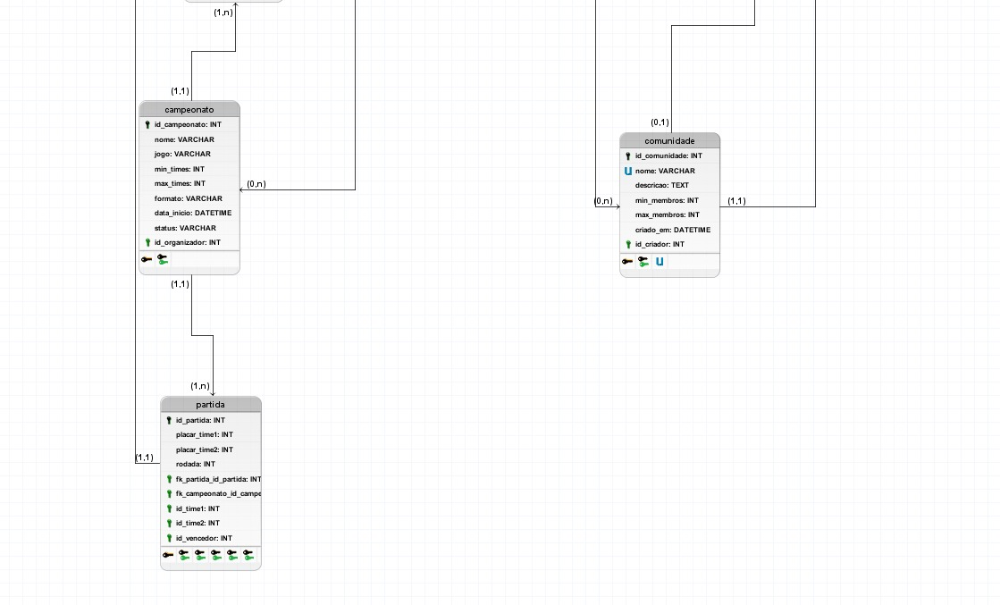

# Modelagem do banco de dados

Os arquivos `.brM3` são os modelos editáveis do brModelo. As imagens abaixo permitem conferir os diagramas diretamente no GitHub. Clique em uma imagem para abrir o tamanho original.

## Modelo conceitual

O modelo identifica as entidades do Rivals Arena e como jogadores, times, comunidades, campeonatos e partidas se relacionam. [Abrir arquivo editável do modelo conceitual](conceitualRivalsArena.brM3)

## Modelo lógico

O modelo organiza entidades e relacionamentos em tabelas com atributos, chaves primárias e chaves estrangeiras. [Abrir arquivo editável do modelo lógico](logicoRivalsArena.brM3)

## Diagrama Entidade–Relacionamento

O DER documenta as nove tabelas da versão publicada, com as cardinalidades, campos e chaves definidos no SQL. [Ver o DER](der.md) · [Ver o script de criação das tabelas](../../arquivos-adicionais/sql/02-criar-tabelas.sql)
