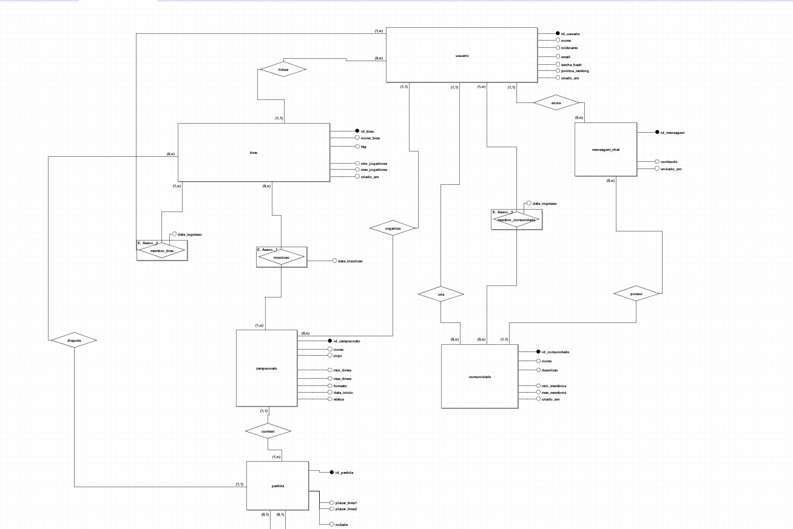
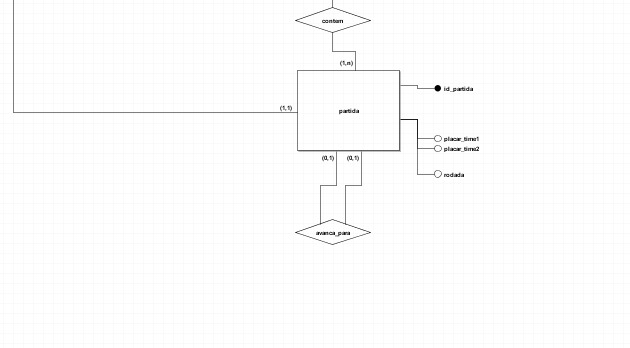

# Modelagem do banco de dados

## Arquivos editáveis do brModelo (.brM3)

| Modelo | Arquivo | Download |
| --- | --- | --- |
| Conceitual | [`conceitualRivalsArena.brM3`](conceitualRivalsArena.brM3) | [Baixar modelo conceitual](https://raw.githubusercontent.com/alicecozendeybs/rivals-arena/main/docs/modelagem/conceitualRivalsArena.brM3) |
| Lógico | [`logicoRivalsArena.brM3`](logicoRivalsArena.brM3) | [Baixar modelo lógico](https://raw.githubusercontent.com/alicecozendeybs/rivals-arena/main/docs/modelagem/logicoRivalsArena.brM3) |

Abra os arquivos `.brM3` no brModelo. Para consultar as imagens pelo GitHub, clique nelas para ver o tamanho original.

## Modelo conceitual

O modelo identifica as entidades do Rivals Arena e como jogadores, times, comunidades, campeonatos e partidas se relacionam.

## Modelo lógico

O modelo organiza entidades e relacionamentos em tabelas com atributos, chaves primárias e chaves estrangeiras.

## Diagrama Entidade–Relacionamento

O DER documenta as nove tabelas da versão publicada, com as cardinalidades, campos e chaves definidos no SQL. [Ver o DER](der.md) · [Ver o script de criação das tabelas](../../arquivos-adicionais/sql/02-criar-tabelas.sql)
