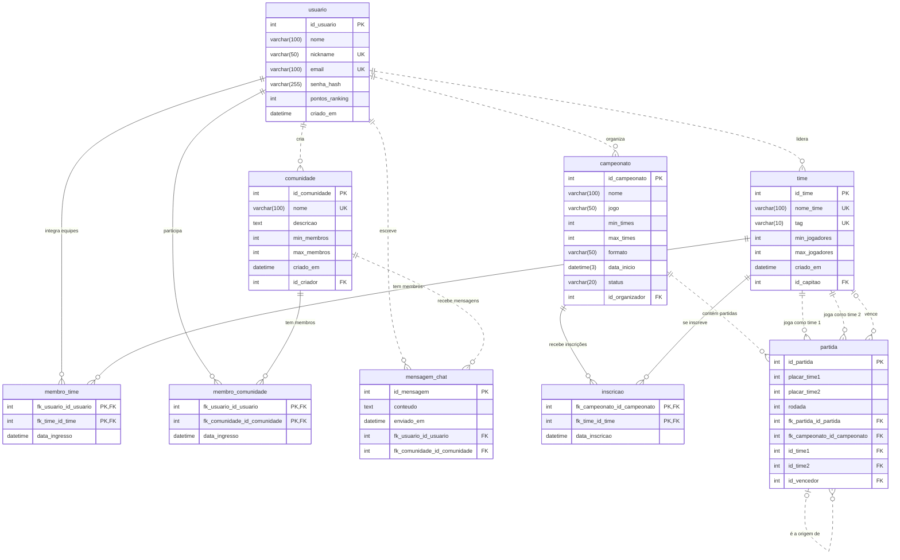

# DER do esquema implementado

O diagrama abaixo foi elaborado a partir do [script de criação das tabelas](../../arquivos-adicionais/sql/02-criar-tabelas.sql). As imagens do brModelo na [pasta de modelagem](README.md) registram os modelos originais do projeto.

`PK` indica chave primária, `FK` indica chave estrangeira e `UK` indica campo único. As tabelas `membro_time`, `membro_comunidade` e `inscricao` usam chaves primárias compostas para evitar vínculos repetidos.

Cada partida referencia os dois times e o campeonato. `id_vencedor` é preenchido quando o organizador registra o resultado. `fk_partida_id_partida` pode apontar para uma partida de origem do chaveamento.
